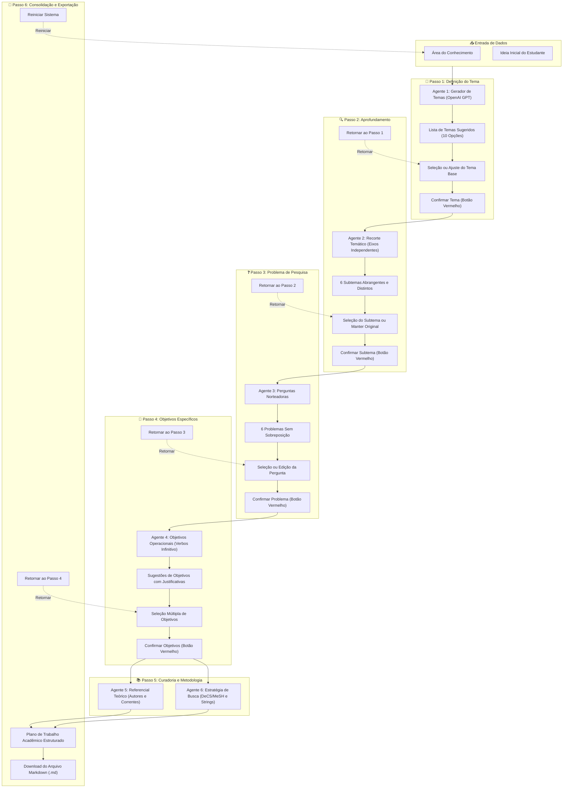

# 🎓 Agente Monografia

> **Sistema de Inteligência Artificial para Escolha de Tema, Problema e Estratégia de Pesquisa para Monografias e TCCs.**  
> *Idealizado por Flávio Seabra ([@fs_orientadoracademico](https://www.instagram.com/fs_orientadoracademico/))*

---

## 📖 Sobre o Projeto

O **Agente Monografia** é uma ferramenta desenvolvida para auxiliar estudantes, orientadores e pesquisadores nas etapas iniciais e cruciais de um Trabalho de Conclusão de Curso (TCC) ou Monografia, com foco especial no modelo de **Revisão Integrativa da Literatura**.

Por meio de agentes inteligentes e modelos de linguagem (OpenAI GPT / LangGraph), o sistema atua de maneira interativa e sequencial para transformar uma ideia inicial genérica em uma estrutura metodológica pronta para execução.

---

## 🚀 Etapas do Fluxo Metodológico

O assistente é organizado em etapas consecutivas e interativas:

1. **Passo 1 — Definição do Tema:** A partir da área do conhecimento e da ideia inicial do estudante, a IA sugere 10 temas viáveis e acadêmicos.
2. **Passo 2 — Delimitação em Subtemas:** O agente mapeia **6 subtemas abrangentes e distintos**, garantindo que nenhum se sobreponha e cobrindo os eixos teóricos, metodológicos, contextuais e de impacto.
3. **Passo 3 — Problema de Pesquisa:** Formula **6 problemas de pesquisa (perguntas norteadoras)** sem sobreposição conceitual, focados em revisão integrativa.
4. **Passo 4 — Objetivos da Pesquisa:** Sugere objetivos específicos com verbos no infinitivo e justificativas metodológicas.
5. **Passo 5 — Curadoria Teórica e Estratégia de Busca:**
   - **Referencial Teórico:** Mapa de autores clássicos e contemporâneos e correntes de pensamento.
   - **Estratégia DeCS/MeSH:** Descritores controlados e strings booleanas (`AND`/`OR`) para PubMed, SciELO, LILACS e Google Acadêmico.
6. **Passo 6 — Consolidação e Exportação:** Visualização unificada e download do Plano de Trabalho em formato Markdown (`.md`).

> [!TIP]
> **Navegação Flexível & Identidade Visual:**  
> A partir do Passo 2, todas as etapas possuem o botão **"Retornar ao passo anterior"**, permitindo revisar escolhas sem reiniciar o trabalho. Todos os botões de confirmação de avanço são destacados em **vermelho**.

---

## 🧠 Arquitetura e Fluxo do Agente



---

## 📁 Estrutura de Arquivos

```plaintext
agente_monografia/
├── app.py                # Interface web principal interativa em Streamlit
├── graph_logic.py        # Grafo de agentes e orquestração do LangGraph
├── requirements.txt      # Dependências do projeto
├── .env.example          # Modelo de variáveis de ambiente
└── .gitignore            # Arquivos ignorados pelo Git (.env, venvs, etc.)
```

---

## 🛠️ Pré-requisitos

- **Python:** Versão 3.10 ou superior instalada.
- **Chave de API da OpenAI:** Obtenha uma chave em [platform.openai.com](https://platform.openai.com/).

---

## ⚙️ Instalação e Configuração

Siga o passo a passo abaixo no terminal na raiz do projeto:

### 1. Criar o Ambiente Virtual (`venv`)

#### No Windows (PowerShell / Prompt de Comando):
```powershell
python -m venv my_env
```

#### No Linux / macOS:
```bash
python3 -m venv my_env
```

---

### 2. Ativar o Ambiente Virtual

#### No Windows (PowerShell):
```powershell
.\my_env\Scripts\Activate.ps1
```
> *Caso ocorra erro de execução de scripts no PowerShell, execute antes:*  
> `Set-ExecutionPolicy -ExecutionPolicy RemoteSigned -Scope Process`

#### No Windows (Prompt de Comando - CMD):
```cmd
my_env\Scripts\activate.bat
```

#### No Linux / macOS:
```bash
source my_env/bin/activate
```

---

### 3. Atualizar o `pip` e Instalar as Dependências

Com o ambiente virtual ativado, execute:

```bash
pip install --upgrade pip
pip install -r requirements.txt
```

---

### 4. Configurar a Chave da OpenAI (`.env`)

Crie um arquivo chamado `.env` na raiz do diretório `agente_monografia` com a sua chave de API:

```env
OPENAI_API_KEY=sua-chave-api-aqui
```

---

## ▶️ Como Executar

Execute a aplicação interativa via **Streamlit**:

```bash
streamlit run app.py
```

O aplicativo abrirá automaticamente no navegador no endereço:  
👉 **`http://localhost:8501`**

---

## 📦 Dependências Principais

- **[Streamlit](https://streamlit.io/):** Criação rápida de interfaces web interativas.
- **[LangGraph](https://github.com/langchain-ai/langgraph) & [LangChain](https://www.langchain.com/):** Orquestração do estado e fluxo dos agentes de pesquisa.
- **[OpenAI API](https://platform.openai.com/docs):** Modelos de linguagem para geração e refinamento dos passos metodológicos.
- **[python-dotenv](https://github.com/theskumar/python-dotenv):** Gerenciamento seguro de variáveis de ambiente.

---

## 🔄 Como Atualizar o Projeto no GitHub

Para enviar suas alterações, novos arquivos ou arquivos removidos para o repositório remoto no GitHub, execute os seguintes comandos no terminal:

### 1. Entrar na pasta do projeto
Caso seu terminal esteja na pasta pai (`projetos`), entre na pasta do repositório:
```bash
cd agente_monografia
```

### 2. Verificar os arquivos modificados
```bash
git status
```

### 3. Adicionar todas as alterações (novos arquivos, modificações e exclusões)
```bash
git add .
```

### 4. Registrar o commit com uma mensagem descritiva
```bash
git commit -m "feat: atualizacoes no agente de monografia, navegacao e documentacao"
```

### 5. (Recomendado) Obter eventuais atualizações remotas
```bash
git pull origin main
```

### 6. Enviar as alterações para o GitHub
```bash
git push origin main
```

> [!IMPORTANT]
> **Segurança de Credenciais:** Certifique-se de que o arquivo `.env` (contendo sua `OPENAI_API_KEY`) **nunca** seja enviado ao GitHub. Ele já está configurado no arquivo `.gitignore` para sua segurança.

---

## 👨‍🏫 Autor & Créditos

Desenvolvido por **Flávio Seabra**  
- Orientação acadêmica, metodologia de pesquisa e inteligência artificial aplicada.  
- Instagram: [@fs_orientadoracademico](https://www.instagram.com/fs_orientadoracademico/)

